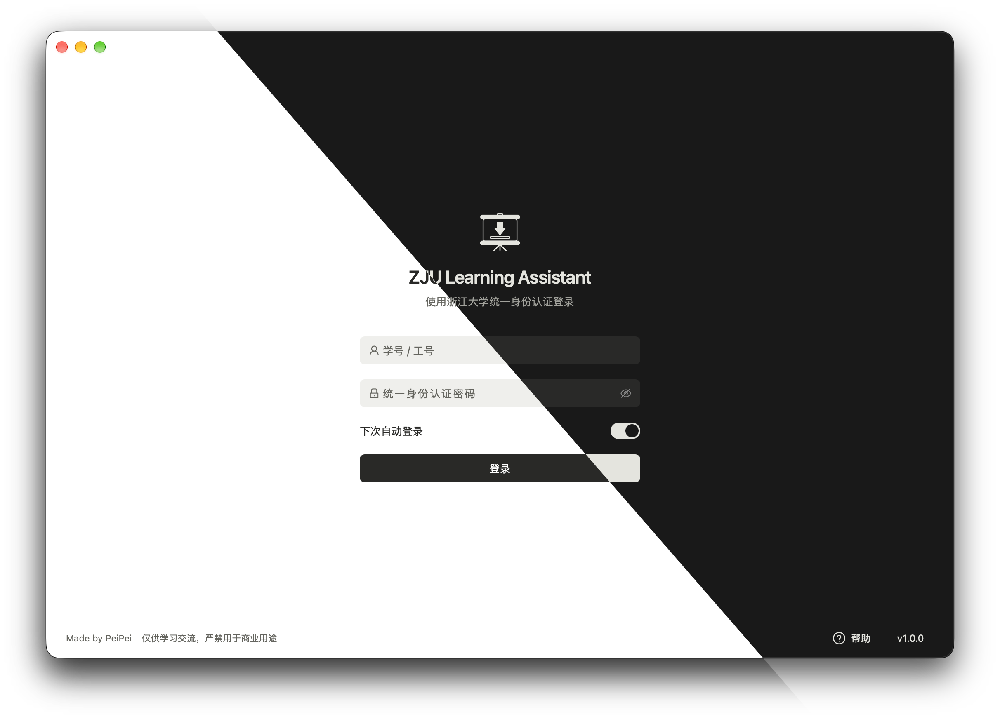
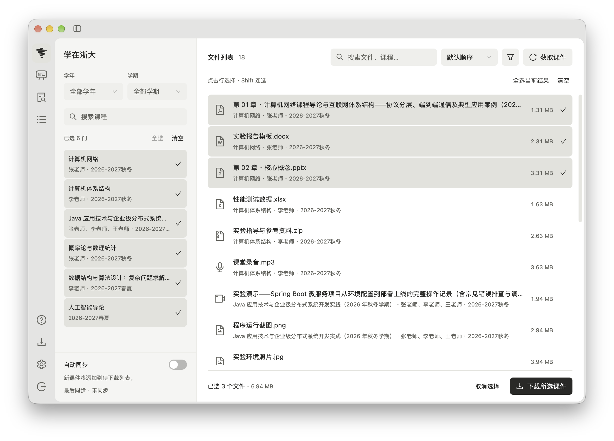
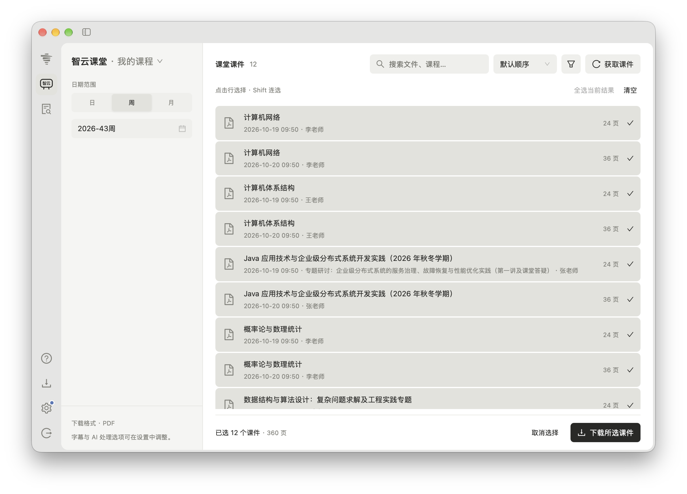
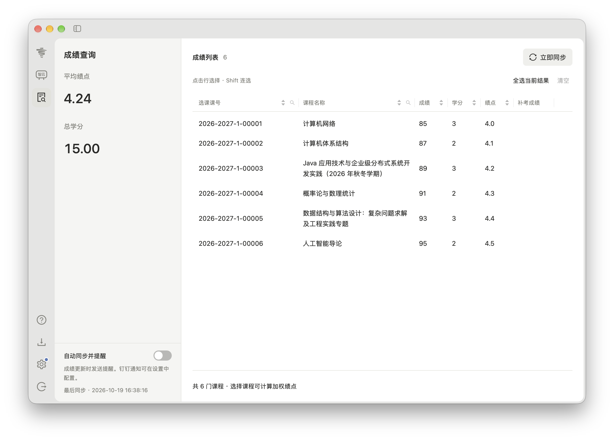
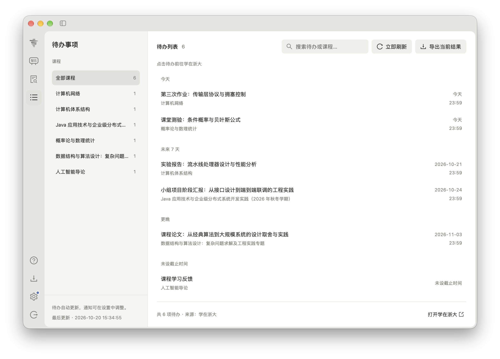

<h1 align="center">
  
   
  ZLA: ZJU Learning Assistant
   
</h1>

<h3 align="center">
帮你快速下载所有课件😋
</h3>

## 特性

- 支持 Windows、Linux、Mac
- 批量下载课件
- 支持下载老师未开放下载的课件的 Preview 版本
- 支持从智云下载 PPT 并导出为 PDF
- 集成成绩更新提醒
- 查看学在浙大待办事项
- 跟随系统暗黑模式

## 开始

P.S. 由于没有购买 CA 签名，ZJU Learning Assistant (aka. ZLA) 没有签名，因此下载、安装、运行过程中可能会被系统拦截，请信任 ZLA 或自行编译。

### 下载安装

从 [Release](https://github.com/PeiPei233/zju-learning-assistant/releases) 下载对应系统的最新版本，安装后打开即可。
- Windows 用户可下载 `.exe` `.msi` 文件进行安装。
- Linux 用户可下载 `.AppImage` 文件，赋予可执行权限后运行。或者下载 `.deb` 文件进行安装。
- Mac 用户可下载 `.dmg` 文件进行安装，或下载 `.app.tar.gz` 文件解压后运行。Intel 对应 `x86_64` 版本，Apple Silicon 对应 `aarch64` 版本。

### 自行编译

1. 安装 [Node.js](https://nodejs.org/en/)、[Rust](https://www.rust-lang.org/tools/install)
2. 克隆本仓库
3. Linux 用户请使用 `sudo apt update && sudo apt install libwebkit2gtk-4.1-dev build-essential curl wget file libxdo-dev libssl-dev libayatana-appindicator3-dev librsvg2-dev` 安装依赖
4. 运行 `npm install` 安装依赖
5. 运行 `cargo install tauri-cli --version "^2.0.0" --locked` 安装 Tauri v2 CLI
6. 运行 `cargo tauri build` 编译，编译后的文件在 `src-tauri/target/release` 目录下

## 使用手册

打开 ZLA 后，请先用本人的浙大统一身份认证登录，即输入登录学在浙大时的学号、密码，登陆成功后才能下载课件。

此界面点击右下角版本号可查看版本信息；有新版时会显示蓝点提示。开启 **下次自动登录** 后，下次打开 ZLA 时会自动登录。

登录后进入以下下载课件的界面。

左侧图标栏可切换 **学在浙大**、**智云课堂**、**成绩查询** 和 **待办事项**，下方提供 **下载列表**、**设置** 和 **退出登录** 入口。点击左上角的侧栏按钮可折叠或展开功能面板。

### 下载学在浙大课件

当选择菜单中的 **学在浙大** 时，可选择学年和学期来筛选课程。选中课程后点击文件列表右上角的 **获取课件**，加载所选课程的课件列表。

选择完所需的课件，点击 **下载所选课件** 按钮，选择的课件会被加入至下载队列中，并从课件列表中删去。

若开启页面中的 **自动同步** 开关，则本软件会每隔 1 ～ 2 分钟自动拉取所选课程的未下载课件，并自动下载。您可在 **设置** 中修改为拉取到新课件后加入下载列表而不是自动下载。

对于由 WPS 提供浏览的文件，普通下载接口失效时，先尝试通过 WPS 下载原文件；原文件仍无法获取时，再导出预览版 PDF。预览版不保证与原文件完全一致，统一命名为 `原文件名.preview.pdf`。增量同步时优先尝试下载原文件，失败后获取预览版，并按文件名和大小判断是否需要重新下载。

如需更改下载或同步课件的路径，您可以进入 **设置** 页面进行修改。

### 下载智云课堂课件

当选择 **智云课堂** 时，点击左侧面板顶部的 **智云课堂 · 我的课程** 可切换到 **全部课程**。**我的课程** 支持按日期查看课堂；**全部课程** 支持按课程名称或教师搜索。点击 **获取课件** 后，选中所需课件并点击 **下载所选课件** 即可加入下载队列。

下载时，下载的课件图片会自动整合为 PDF。您可在 **设置** 中关闭此功能。

### 成绩查询与更新提醒

在 **成绩查询** 中可以查看成绩。登录后，ZLA 会每隔 1 ～ 2 分钟自动刷新成绩，也可点击 **立即刷新** 手动更新。可在 **设置** > **下载与同步** > **同步** 中关闭成绩自动同步，关闭后仅在登录时自动刷新。成绩更新提醒可在 **设置** > **通知** 中开启，支持系统通知和钉钉通知。

使用钉钉通知时，请在钉钉创建一个内部群，并在群中添加自定义机器人，将其 Webhook 填入 **设置** > **通知** > **钉钉机器人**。如果机器人的安全设置启用了加签，还需填写对应的密钥 Secret；如果使用自定义关键词，请确保关键词能匹配消息内容，例如分别添加 `成绩` 和 `待办`，以接收两类通知。

配置完成后，可点击成绩或待办的 **钉钉通知** 开关旁的发送按钮，向群中发送一条测试通知。

### 查看/导出学在浙大待办事项

在左侧导航进入 **待办事项**，可按课程筛选、搜索当前待办，并按截止时间分组查看。点击待办可前往学在浙大处理。ZLA 会自动刷新待办列表，也可点击 **立即刷新** 手动更新。可在 **设置** > **下载与同步** > **同步** 中关闭待办自动同步，关闭后仅在登录时自动刷新，已获取的待办仍会按设置提醒。

可在 **设置** > **通知** 中选择提前 15 分钟、30 分钟、1 小时、2 小时或 1 天提醒，支持多选，并分别开启系统通知和钉钉通知。请保持应用运行以接收提醒。如需使用钉钉通知，请先按上方 [成绩查询与更新提醒](#成绩查询与更新提醒) 中的说明配置钉钉机器人。

在 ZLA 的任务栏图标菜单中，您也可以查看或导出学在浙大的待办事项。当您选择菜单中的 **导出待办事项** > **导出为 iCalendar 文件** 后，ZLA 会将所有待办事项导出为 `.ics` 文件。通过待办页面右上角的 **导出当前结果** > **导出为 iCalendar 文件** 则是导出页面中筛选的待办。您可以将该文件导入到日历软件中，以便查看学在浙大的待办事项。例如，如果您想跨平台并且去重，可以导入到 Google 日历中。

也可以通过 **CalDAV** 导出到日历服务。在 **设置** > **下载与同步** > **CalDAV** 中填写服务器地址、用户名和密码或授权码，应用会自动获取可用列表，再选择日历和待办列表作为导出位置。

配置完成后，在待办页面或任务栏菜单中选择 **导出到 CalDAV 日历** 或 **导出到 CalDAV 待办事项**。日历仅接收有截止时间的待办，待办列表也支持没有截止时间的事项；可用的导出类型取决于服务支持情况。重复导出不会重复创建同一条目，待办内容变化后可再次导出更新。此功能需要手动导出，不会随待办自动刷新而同步。

对于 macOS 用户，还可以选择将待办事项导入到 **日历 App** 或 **提醒事项 App** 中：
- **导入到日历 App**：ZLA 会将待办事项导入到一个名为 `Learning in ZJU` 的日历中，并自动忽略重复的待办。如果该日历不存在，则会自动创建，由 ZLA 自动创建的日历默认保存在 iCloud 中。
- **导入到提醒事项 App**：ZLA 会将待办事项导入到默认待办列表中。若您已经打开了默认待办列表的 iCloud 同步，则会自动同步到 iCloud。

未设置截止时间的待办不会导出到日历或 iCalendar 文件，但可以导出到支持待办事项的 CalDAV 列表或 macOS 的 **提醒事项 App**。

ZLA 仅在第一次使用这个功能时会自动弹出权限申请对话框，若授权失败，后续需自己去系统设置中开启。打开 **系统设置** > **隐私与安全性** > **日历**（或 **提醒事项**），找到 zju-learning-assistant 并勾选，给予完全访问权限。

## 我的信息是否安全？

ZLA 实质上是一个爬虫，模拟登录学在浙大、获取课件列表、下载课件的过程。因此，ZLA 需要你的学号、密码才能正常运行。

ZLA 不会将你的学号、密码上传到任何服务器，用于自动登录所保存的学号和密码使用了操作系统自带的密钥管理服务（详见 [keyring-rs](https://github.com/hwchen/keyring-rs)）。你可以查看源代码来确认这一点。在使用过程中，ZLA 只会访问以下网站：

- `zju.edu.cn`：用于登录学在浙大、获取课件列表、下载课件
- `api.github.com`、`gitee.com`：用于检查更新

## 为什么要开发这个软件？

**Rewrite in Rust!**

之前 QSC 坏掉的时候自己用爬虫写了个计算绩点的 Python 脚本，后来 QSC 修好了，就用它做了个[成绩更新的钉钉机器人推送](https://github.com/PeiPei233/zju-score-push-template)。奈何 Python 做 GUI 打包分发太过于麻烦，于是想着换个语言重写一下爬虫脚本。看到之前 n+e 学长做过一个 [清华大学新版网络学堂课程自动下载脚本](https://github.com/Trinkle23897/learn2018-autodown)，想到自己曾经补天的时候下载 ppt 时是多么的繁琐，于是就想着写一个类似的软件。经过一顿摸索之后发现 Rust + Tauri 这个组合非常好用，至少 Rust 的爬虫比 Node.js 的爬虫好用很多，接近 Python 的爬虫体验了，于是放弃 Electron 转投 Tauri。

感谢几位友人在开发和测试过程中的鼎力相助：[@wangwhh](https://github.com/wangwhh) [@stormckey](https://github.com/stormckey) [@VVsxmja](https://github.com/VVsxmja) [@abmfy](https://github.com/abmfy)

## 免责声明

ZLA 实际上是在模拟您在浏览器中登录学在浙大、获取课件列表、下载课件的过程，且不会妨碍学校系统正常工作。请您在使用中遵守学校的相关规定，尊重、保护他人的知识产权。ZLA 不对您的任何行为负责，造成的任何后果由您自行承担。

出于版权考虑，ZLA 不会支持自动下载智云课堂视频。